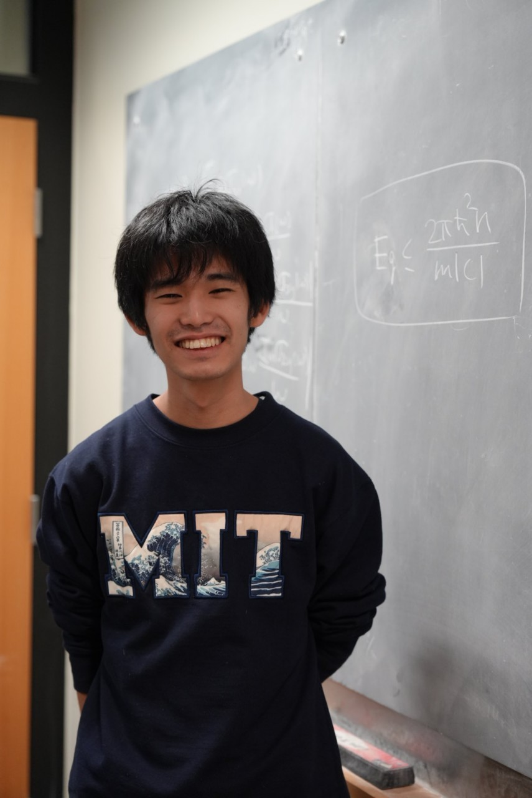

<!--  -->

Profile
=====
* Leinweber Postdoctoral Fellow at Stanford University
* Office: Room 328 at [McCullough Building](https://maps.app.goo.gl/Gx2T4dv2PHnHGTBQA), Stanford Univesity
* Email: yugo0o24\_at\_stanford.edu   (please replace \_at\_ with @)
* Recent preprints: [arXiv](https://arxiv.org/search/cond-mat?searchtype=author&query=Onishi,+Y)
* Publications: See [Google Scholar](https://scholar.google.com/citations?user=f1QuhscAAAAJ&hl=en) or [Publications](https://yugoonishi.github.io/publications/)

Research Interests
=====
Topology and quantum geometry in condensed matter and its relation to responses

Updates
=====


[View all updates]({{ "/updates/" | relative_url }})
